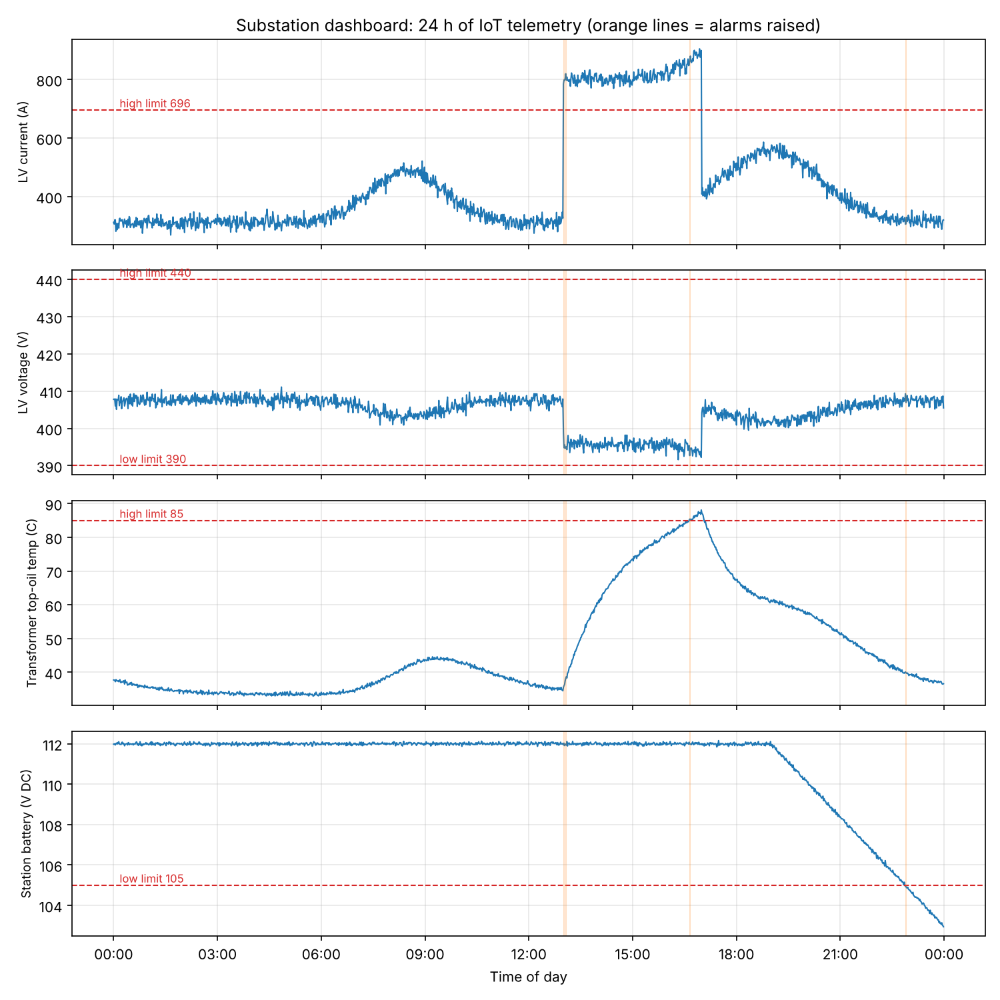

# Substation Monitoring using IoT

A Python simulation of an IoT monitoring system for an 11 kV / 415 V distribution substation. An edge node publishes sensor data over MQTT to a cloud monitor, which raises alarms and draws a dashboard.

**Author:** Rachana Santhebachahalli Umesha · Personal project, 2026

## Architecture

```
Field sensors            Edge node              MQTT broker           Cloud monitor
CT  -> LV current   ─┐                                                ├─ limit checks + hysteresis
PT  -> LV voltage    ├─► ESP32-style node ──► topic:                ─►├─ rate-of-rise early warning
PT100 -> oil temp    │   JSON every 60 s      substation/<site>/       ├─ alarm log (raised/cleared)
Battery monitor     ─┘   over Wi-Fi           telemetry               └─ 24 h dashboard
```

- **Substation model:** a 500 kVA transformer (696 A rated LV current) following a daily load curve with morning and evening peaks. Top-oil temperature follows a first-order thermal model (90-minute time constant), and LV voltage drops as load rises.
- **Injected faults:** a heat-wave overload to 1.3 pu from 13:00 to 17:00, and a station battery charger failure at 19:00.
- **MQTT:** a minimal in-process broker stands in for Mosquitto, with the same topic-based publish/subscribe pattern. Each message is a JSON payload such as `{"ts": "2026-07-15T00:00:00", "current_A": 311.7, "voltage_V": 407.8, "oil_temp_C": 37.7, "battery_V": 111.98}`.

## Alarm logic

| Measurement | Alarm limit | Clears below/above |
| --- | --- | --- |
| LV current | > 696 A (rated) | 661 A |
| LV voltage | < 390 V or > 440 V | 393 V / 437 V |
| Top-oil temperature | > 85 °C | 82 °C |
| Oil temperature rise | > 0.25 °C/min over 10 min | < 0.125 °C/min |
| Station battery (110 V DC) | < 105 V | 106 V |

An alarm is raised only after 2 consecutive bad samples, and clears only once the value is back past the deadband. In an earlier version without hysteresis, the overload alarm toggled on and off dozens of times in one afternoon (alarm chattering). With it, each fault gives one clean raise and one clear.

## Results (24 h, 1,440 MQTT messages)



| Time | Event |
| --- | --- |
| 13:01 | Overload raised (peak 1.30 pu) |
| 13:04 | Fast oil temperature rise raised: early warning 3.5 hours before the absolute limit |
| 14:55 | Fast rise cleared |
| 16:39 | High oil temperature raised (peak 88.1 °C) |
| 17:00 | Overload cleared |
| 17:12 | High oil temperature cleared |
| 22:54 | Low battery raised, about 4 hours after the charger failed (min 102.9 V) |

The rate-of-rise alarm is the most useful one: it warned operators at 13:04 that the transformer was heating fast, well before it crossed 85 °C at 16:39. Full output is in [results.txt](results.txt).

## Run it

```bash
pip install -r requirements.txt
python substation_iot.py
```

## Possible next steps

- Swap the in-process broker for a real Mosquitto broker using `paho-mqtt`
- Run the edge node code on an ESP32 with a CT clamp and a DS18B20 temperature sensor
- Add a live web dashboard (for example Node-RED or Grafana)
